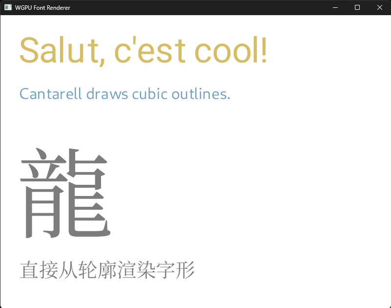

# wgpu-font-renderer

[](https://crates.io/crates/wgpu-font-renderer)
[](https://docs.rs/wgpu-font-renderer)
[](https://github.com/ValentinRio/wgpu-font-renderer/actions/workflows/ci.yml)

GPU-centered font rendering for [wgpu](https://wgpu.rs/). Glyphs are drawn straight from their outlines in the fragment shader. No signed distance field cache of any sort.



## Features

- Reads outlines from TrueType and OpenType (CFF/CFF2) files.
- Analytic coverage computed per pixel from the outline's quadratic curves.
- Nonzero winding rule, so overlapping contours fill instead of rendering as holes.
- Grayscale anti-aliasing by default, opt-in subpixel (LCD) anti-aliasing.
- Text shaping with [swash](https://github.com/dfrg/swash).
- Runs natively and in the browser through WebGPU.

Variable fonts support axis selection through `FontStore::load_variation`; LCD mode has no filter. See the [roadmap](#roadmap).

## Installation

```toml
[dependencies]
wgpu-font-renderer = "0.2"
```

Enable the backends you want on your own `wgpu` dependency; a plain `wgpu = "30"` enables the defaults.

## Usage

These examples target the upcoming 1.0 API. For changes from the published 0.2
API, see [the migration guide](CHANGELOG.md#migrating-from-02).

```rust
use wgpu_font_renderer::{FontStore, TextRenderer, TypeWriter};

// Once, at startup. `config` is your wgpu::SurfaceConfiguration.
// The preset string lists the characters your app will draw.
let mut font_store = FontStore::new(&device);
let cache_preset = "abcdefghijklmnopqrstuvwxyzABCDEFGHIJKLMNOPQRSTUVWXYZ0123456789,;:!ù*^$=)àç_è-('\"é&²<>+°§/.? ";
let font_key = font_store
    .load(&device, &queue, "fonts/Roboto-Regular.ttf", cache_preset)
    .expect("Couldn't load the font");
let mut text_renderer = TextRenderer::new(&device, config.format, &font_store);
// Before the first render and on every viewport change.
text_renderer.resize(&queue, [config.width, config.height]);

// Whenever the text changes: shape paragraphs.
// Arguments: font, position on screen, font size, linear RGBA color, text.
let mut type_writer = TypeWriter::new();
let mut paragraphs = Vec::new();
if let Some(paragraph) = type_writer.shape_text(&font_store, font_key, [100., 100.], 72., [0.68, 0.5, 0.12, 1.], "Salut, c'est cool!") {
    paragraphs.push(paragraph);
}
// Once per queue submit, prepare every paragraph of the frame.
text_renderer.prepare(&device, &queue, &paragraphs, &font_store);

// Inside an existing render pass.
text_renderer.render(&mut pass);
```

Call `prepare` once per queue submit with every paragraph of the frame. A second
`prepare` before the submit can change what earlier `render` calls of that submit
draw. For layers, prepare both lists together and draw ranges at different points
of a pass (or in different passes):

```rust
text_renderer.prepare(
    &device, &queue, body.iter().chain(overlay.iter()), &font_store,
);
text_renderer.render_range(&mut pass, 0..body.len()); // Text below.
// Draw something else into the same pass here.
text_renderer.render_range(&mut pass, body.len()..); // Text on top.
// End the pass, then submit the encoder once.
```

Font sizes are `f32` physical pixels per em. Fonts loaded after renderer construction
are picked up by the next `prepare` call. Paragraph fields are read through getters;
use `set_position`, `set_color`, `push` (zero offset), and `push_at` to edit a run.
`glyphs()` returns `ShapedGlyph` values with a glyph ID, advance, and `[x, y]`
offset in physical pixels, x rightward and y downward. Every shaped glyph is
retained. Script runs are shaped in logical order; bidi reordering and line
wrapping are not implemented.

Glyph zero is always cached when it has an outline, so characters the font lacks
draw `.notdef`; an empty `.notdef` advances without drawing. Controls (Cc) and
default-ignorable characters mapped to glyph zero are omitted without advance. Other uncached
outlines are skipped. Loads that exhaust the atlas return `LoadingError::AtlasFull`
with the glyph IDs that did not fit, leaving earlier fonts usable.
Glyph ink is positioned at the pen plus its shaped offset plus the cached left
side bearing scaled to pixels. In 0.2, each glyph's ink was anchored at the pen;
text now shifts by each glyph's bearing. TrueType outlines apply the standard
`hmtx.lsb - glyf.xMin` shift, so their cached box and bearing follow `hmtx`.
CFF outline coordinates are unchanged; their bearings also position the ink.

Atlas-full errors arise when an outline or its bands cannot fit a layer, or
allocation would exceed the device's `max_texture_array_layers`. The default
512 × 2048 RGBA32Float layers use 16 MiB each, initially 32 MiB for two layers;
a 256-layer device limit allows a 4 GiB atlas. Growth temporarily keeps both
the old and new textures in memory. A load that grows the atlas and then fails
restores allocation bookkeeping but keeps the larger texture.

### Metrics and variable-font instances

`FontStore::metrics(font, size)` returns `FontMetrics` in physical pixels, with
the renderer’s anchor ascender (usually positive, but zero or negative for
unusual fonts), nonnegative descent magnitude (possibly zero), and a signed line
gap that may be positive, zero or negative. Table selection intentionally differs
from skrifa’s `Metrics`: typo metrics require OS/2 v4 with USE_TYPO_METRICS;
a zero hhea ascender falls back to nonzero typo, then Windows metrics. This
matches where glyphs are drawn. A paragraph’s baseline is `position.y + ascent`.
Invalid sizes and foreign font IDs return `None`. `FontStore::axes(font)` borrows a cached slice of
`Axis` records with four-byte tags and minimum, default and maximum values (an
empty slice for a non-variable font).

```rust
let bold = fonts.load_variation(device, queue, base, &[(*b"wght", 700.0)])?;
let metrics = fonts.metrics(bold, 32.0).expect("valid font and size");
let baseline = 24.0 + metrics.ascent;
```

Instances share the base’s bytes and character set and upload their own outlines.
Axis values clamp to their ranges, unknown tags are ignored, omitted axes retain
the base instance’s values, and the last duplicate wins. Non-variable fonts
produce identical instances. A foreign base returns `LoadingError::UnknownFont`. One skrifa
normalized location drives outlines, bounds, bearings, MVAR line metrics and
swash shaping, including all-zero coordinates at the default instance so
FeatureVariations whose conditions cover zero apply. Every instance uploads its own outlines for the
base’s character set. Fonts are never unloaded, so creating instances per frame
(for example when animating weight) fills the atlas and ends in `AtlasFull`.

### Untrusted fonts

Font bytes are parsed by skrifa and swash. Outlines come from `glyf`, then
`CFF2`, then `CFF`; a `VARC` table is ignored. The loader enforces per-glyph
work limits before and while drawing an outline: at most 65,535 points and
16,384 contours after composite expansion, 4,096 composite component references
and 16,384 encoded segments. A glyph past a limit fails the load with
`LoadingError::GlyphTooComplex`. The limits are loader policy, not font
validity rules, so a valid but very complex glyph can be refused. Measured: the
outlines of every Unicode-mapped character plus glyph zero load within them for
28 fonts (DejaVu and Liberation families, Noto Color Emoji, Roboto, Cantarell and
a Noto Serif SC subset); unmapped glyphs and full CJK fonts were not measured.
A seeded robustness test over random and corrupted fonts found no panic in this
crate after the fixes above; that is tested behaviour, not a proof. Two limits
remain upstream: swash's `cmap` lookup uses unchecked
arithmetic, so a crafted `cmap` panics in debug builds (release builds map the
character to a wrong glyph instead), and skrifa bounds CFF subroutine nesting
but not total work, so a crafted CFF glyph can take a long time to load even
though its memory stays bounded.

`FontStore::load` reads the font from a file path. On wasm, or to embed the font in the binary, use `FontStore::load_from_bytes`.

A complete program is in [`examples/simple.rs`](examples/simple.rs).

### Subpixel (LCD) anti-aliasing

For subpixel (LCD) anti-aliasing, create the renderer with `TextRenderer::with_subpixel_order(&device, config.format, &font_store, SubpixelOrder::Rgb)` (or `SubpixelOrder::Bgr`), and request `wgpu::Features::DUAL_SOURCE_BLENDING` when creating the device. Without that feature the renderer stays grayscale and `lcd_active()` returns `false`. `TextRenderer::new` is always grayscale.

In LCD mode the horizontal ray is evaluated once and its coverage is taken at three positions a third of a pixel apart, one per channel; the vertical ray is shared. LCD output assumes a horizontal RGB or BGR panel, text drawn over an opaque background, and no rotation or scaling after rendering. Both LCD and grayscale (including the LCD fallback) scale coverage by `color.a`. Alpha zero draws nothing; alpha one preserves full coverage. There is no LCD filter yet, so small sizes show some colour fringing.

## Running the examples

Run the native example:

```sh
cargo run --example simple
```

To run the same example in a browser:

1. Install the target and the CLI version matching `wasm-bindgen` in `Cargo.lock`:

   ```sh
   rustup target add wasm32-unknown-unknown
   cargo install wasm-bindgen-cli --version 0.2.129
   ```

2. Build the example:

   ```sh
   cargo build --release --example simple --target wasm32-unknown-unknown
   ```

3. Generate the browser bindings:

   ```sh
   wasm-bindgen --target web --out-dir examples/web/pkg target/wasm32-unknown-unknown/release/examples/simple.wasm
   ```

4. Serve `examples/web` on localhost with any static file server, then open it in a WebGPU-capable browser. WebGPU requires a secure context, such as localhost or HTTPS. A LAN IP over plain HTTP will not expose WebGPU.

## Testing

Run `cargo test --all-features --offline`. Native GPU tests skip with a diagnostic when no adapter
is available. Set `REQUIRE_GPU=1` to fail instead, so CI cannot silently skip GPU
coverage:

```sh
REQUIRE_GPU=1 cargo test --all-features --offline
```

CI runs the suite on Mesa lavapipe with `REQUIRE_GPU=1`. A software adapter
such as lavapipe is sufficient. GPU tests are disabled on
wasm32. No tests are marked ignored.

## Benchmarking

```sh
cargo bench --all-features --offline --bench shader
```

The shader benchmark renders four fixed scenes and can compare a branch against a saved baseline. Options, methodology and how to read the verdicts are in [`benches/README.md`](benches/README.md).

## How it works

Coverage is computed analytically, following Eric Lengyel's paper [GPU-Centered Font Rendering Directly from Glyph Outlines](https://jcgt.org/published/0006/02/02/) (JCGT, 2017), the method behind Slug. The shader was written from the paper, not from the reference implementation. The patent on the method (US 10,373,352) was dedicated to the public domain in March 2026.

For each pixel the fragment shader casts two rays through the pixel centre, one horizontal and one vertical, and finds where they cross the glyph's quadratic curves. Which of a quadratic's two roots counts is decided from the signs of its three control points relative to the ray, so a ray through a shared endpoint counts once and a tangent ray cancels. Each crossing adds `clamp(0.5 + distance in pixels, 0, 1)` with the crossing's winding sign. The absolute sum, clamped to one, is that ray's coverage (the nonzero rule, so overlapping contours fill), and the two rays are blended with more weight on the one whose nearest crossing is closer. There is no cubic solve and no trigonometry.

Two centre rays approximate a box filter. They are exact on axis-aligned edges away from corners and can be off by a fraction of a pixel's coverage where an outline vertex or a very tight feature sits inside the pixel.

Each glyph has up to 16 horizontal bands and up to 16 vertical bands. A band lists every curve whose extent overlaps it. The horizontal ray reads the pixel's horizontal band, sorted by maximum x descending, and stops at the first curve that lies more than half a pixel to the left of the leftmost sample (the pixel centre in grayscale, a third of a pixel further left with LCD); the vertical ray does the same in the vertical band, sorted by maximum y. Glyph quads are drawn half a pixel larger on each side so edge anti-aliasing is not clipped at the bounding box.

## Roadmap

- [x] Separate glyph outlines into bands, so each pixel only tests the curves that can cross it
- [x] Sort curves inside each band, so the shader can stop early (depends on bands)
- [x] Optimize the curve data layout: pack each eight-float record into two RGBA32F texels, fetch the sort key before curve geometry, and derive atlas width from texture dimensions
- [x] Subpixel (LCD) anti-aliasing
- [x] Handle overlapping contours: coverage uses the nonzero winding rule, so overlaps fill instead of rendering as holes
- [x] Add a CFF1 (`.otf`) test font: the Noto Serif SC subset in `fonts/`
- [x] Select variable font axes with shared font bytes and consistent outlines, metrics and shaping

See the [open issues](https://github.com/ValentinRio/wgpu-font-renderer/issues) for a full list of proposed features (and known issues).

## Built with

- [swash](https://github.com/dfrg/swash) for text shaping
- [skrifa](https://github.com/googlefonts/fontations) to read TrueType and OpenType files
- [wgpu](https://wgpu.rs/) 30 as graphics API

## Contributing

Issues and pull requests are welcome.

## License

Licensed under either of the [Apache License, Version 2.0](LICENSE-APACHE) or the [MIT license](LICENSE-MIT), at your option.
